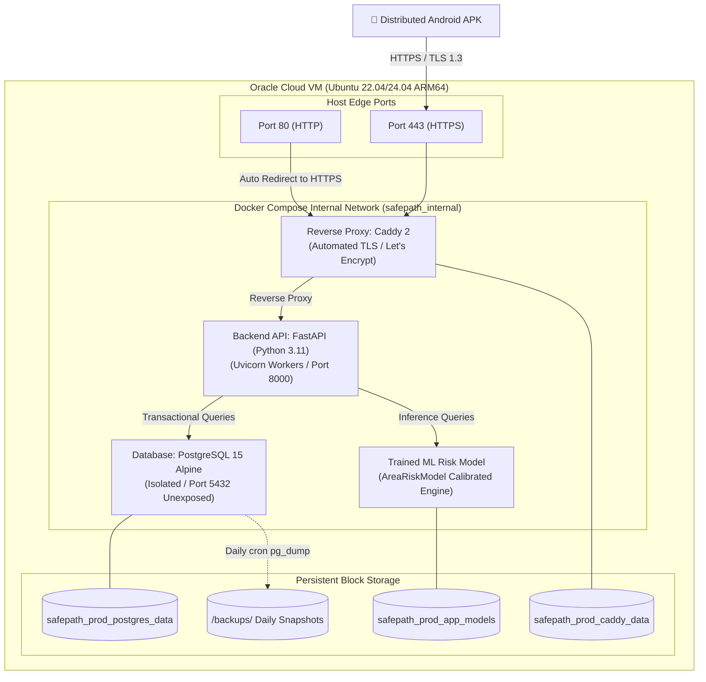

# SafePath AI — Oracle Cloud Infrastructure (OCI) Production Deployment Guide

This guide details the complete, production-grade deployment of the **SafePath AI** backend platform onto **Oracle Cloud Infrastructure (OCI) Always Free Tier** using an Ampere A1 ARM64 virtual machine.

Following this procedure makes SafePath AI independently accessible from any distributed Android device without requiring a developer laptop, local Wi-Fi network, USB cable, or ADB reverse proxy.

---

## 🏛️ Production Architecture Overview



### Key Security & Architecture Properties
1. **Zero Public DB Exposure:** PostgreSQL runs strictly inside the Docker internal bridge network (`safepath_internal`). Port 5432 is **never** published to the host or internet.
2. **Automated HTTPS Termination:** Caddy manages automated Let's Encrypt / ZeroSSL TLS certificates, automatic HTTP-to-HTTPS redirection, and modern security headers (HSTS, nosniff, frame denial).
3. **Native ARM64 Optimization:** Multi-arch container images (`python:3.11-slim`, `postgres:15-alpine`, `caddy:2-alpine`) run natively on OCI Ampere A1 processors without emulation overhead.
4. **Automated Schema Migrations:** Production entrypoint automatically validates database connectivity and executes Alembic database migrations (`alembic upgrade head`) before traffic is routed.
5. **Disaster Recovery:** Daily automated, compressed PostgreSQL dumps with a 7-day rolling retention policy.

---

## Step 1: Oracle Cloud Always Free VM Provisioning

### 1.1 Compute Instance Specification
In the OCI Console, navigate to **Compute > Instances > Create Instance**:

- **Name:** `safepath-prod-vm`
- **Compartment:** Select your default compartment.
- **Placement / Availability Domain:** Any available AD in your home region.
- **Image:** `Canonical Ubuntu 22.04 Minimal` or `Ubuntu 24.04 Minimal` (Architecture: `aarch64`).
- **Shape:** `Ampere` > `VM.Standard.A1.Flex`
  - **OCPUs:** `2` (or up to `4` under Always Free limit).
  - **Memory:** `12 GB` (or up to `24 GB` under Always Free limit).
- **Networking:**
  - **Virtual Cloud Network:** Create new VCN with Internet Connectivity (or select existing).
  - **Subnet:** Public Subnet.
  - **Public IPv4 Address:** Assign a public IPv4 address (`Yes`).
- **SSH Keys:** Generate or upload your personal SSH public key (`~/.ssh/id_ed25519.pub` or `~/.ssh/id_rsa.pub`).
- **Boot Volume:** Default (50 GB to 100 GB Always Free).

Click **Create** and wait for the instance status to turn **Running** (green). Note the **Public IP Address** (e.g., `129.154.XX.YY`).

---

## Step 2: OCI Network & Firewall Configuration

OCI requires opening ports at **two independent layers**:
1. OCI Cloud VCN Ingress Rules (Cloud firewall).
2. Ubuntu Host OS `iptables` / `ufw` (Host firewall).

### 2.1 OCI VCN Security List (Cloud Layer)
In the OCI Console, navigate to **Networking > Virtual Cloud Networks > [Your VCN] > Security Lists > Default Security List for [Your VCN]**.

Click **Add Ingress Rules** and add the following:

| Source CIDR | IP Protocol | Source Port Range | Destination Port Range | Description |
| :--- | :---: | :---: | :---: | :--- |
| `0.0.0.0/0` | TCP | All | `22` | SSH Remote Access (Restrict to your IP if static) |
| `0.0.0.0/0` | TCP | All | `80` | HTTP (Caddy ACME Challenge & HTTPS Redirection) |
| `0.0.0.0/0` | TCP | All | `443` | HTTPS (Secure SafePath Mobile Traffic) |

> [!CAUTION]
> **NEVER** add ingress rules for port `5432` (PostgreSQL) or port `8000` (FastAPI). All external traffic must terminate at Caddy on ports `80`/`443`.

---

### 2.2 Host OS Firewall Rules (Ubuntu VM Layer)
Connect to your VM via SSH:
```bash
ssh -i ~/.ssh/your_private_key ubuntu@<YOUR_OCI_PUBLIC_IP>
```

> [!IMPORTANT]
> Canonical Ubuntu images on OCI include pre-installed `iptables` rules that drop incoming traffic on ports 80 and 443 by default, even if the OCI Security List allows them!

Run the following commands on the VM to open the ports at the OS level:
```bash
# Allow HTTP and HTTPS in iptables
sudo iptables -I INPUT 6 -m state --state NEW -p tcp --dport 80 -j ACCEPT
sudo iptables -I INPUT 6 -m state --state NEW -p tcp --dport 443 -j ACCEPT

# Persist iptables rules across reboots
sudo apt-get update && sudo apt-get install -y iptables-persistent
sudo netfilter-persistent save
sudo netfilter-persistent reload
```

---

## Step 3: Install Docker & Docker Compose on Ubuntu ARM64

Execute on the VM:
```bash
# Remove any conflicting packages
sudo apt-get remove -y docker docker-engine docker.io containerd runc || true

# Install prerequisites
sudo apt-get update
sudo apt-get install -y ca-certificates curl gnupg lsb-release

# Add Docker's official GPG key
sudo install -m 0755 -d /etc/apt/keyrings
curl -fsSL https://download.docker.com/linux/ubuntu/gpg | sudo gpg --dearmor -o /etc/apt/keyrings/docker.gpg
sudo chmod a+r /etc/apt/keyrings/docker.gpg

# Set up repository for aarch64
echo \
  "deb [arch=$(dpkg --print-architecture) signed-by=/etc/apt/keyrings/docker.gpg] https://download.docker.com/linux/ubuntu \
  $(. /etc/os-release && echo "$VERSION_CODENAME") stable" | \
  sudo tee /etc/apt/sources.list.d/docker.list > /dev/null

# Install Docker Engine, CLI, and Compose plugin
sudo apt-get update
sudo apt-get install -y docker-ce docker-ce-cli containerd.io docker-buildx-plugin docker-compose-plugin

# Allow 'ubuntu' user to run docker without sudo
sudo usermod -aG docker ubuntu
newgrp docker
```

Verify installation:
```bash
docker --version
docker compose version
```

---

## Step 4: Repository Setup & Environment Configuration

### 4.1 Clone Repository
```bash
cd ~
git clone https://github.com/ISH2-u/SafePath.git
cd SafePath
```

### 4.2 Configure Production Environment (.env.prod)
```bash
cp .env.prod.example .env.prod
nano .env.prod
```

Configure the following fields:
```ini
PROJECT_NAME="SafePath AI Backend"
ENVIRONMENT="production"
DEBUG="false"
API_V1_STR="/api/v1"

# Domain Configuration:
# Option A: Your custom registered domain (e.g., DOMAIN="safepath.mycompany.com")
# Option B: Free dynamic DNS (e.g. DuckDNS: DOMAIN="safepath-app.duckdns.org")
# Option C: Direct wildcard IP DNS (e.g., if VM IP is 129.154.20.10, set DOMAIN="129-154-20-10.sslip.io")
DOMAIN="your-domain-or-subdomain.com"
ACME_EMAIL="your-email@example.com"

# Generate a fresh 64-char hex key via: openssl rand -hex 32
SECRET_KEY="<PASTE_GENERATED_SECRET_KEY>"
ALGORITHM="HS256"
ACCESS_TOKEN_EXPIRE_MINUTES="10080"

# Isolated PostgreSQL Credentials
POSTGRES_USER="safepath_admin"
POSTGRES_PASSWORD="<GENERATE_STRONG_RANDOM_PASSWORD>"
POSTGRES_DB="safepath_production"

WEB_CONCURRENCY="2"
ALLOWED_ORIGINS="*"
ML_MODEL_PATH="/app/models/area_risk_model.joblib"
```

Save and exit (`Ctrl+O`, `Enter`, `Ctrl+X`).

---

## Step 5: Launch Production Containers

Start the production stack in detached mode:
```bash
docker compose -f docker-compose.prod.yml up -d --build
```

### 5.1 Verify Services & Health Status
```bash
docker compose -f docker-compose.prod.yml ps
```

Expected output:
```text
NAME                   IMAGE                 COMMAND                  SERVICE         STATUS                    PORTS
safepath_prod_db       postgres:15-alpine    "docker-entrypoint.s…"   db              Up (healthy)              5432/tcp
safepath_prod_backend  safepath-backend      "./entrypoint.sh"        backend         Up (healthy)              8000/tcp
safepath_prod_proxy    caddy:2-alpine        "caddy run --config …"   reverse-proxy   Up                        0.0.0.0:80->80/tcp, 0.0.0.0:443->443/tcp
```

### 5.2 Validate Health Check Endpoints
From your local laptop or terminal:
```bash
# Test HTTP to HTTPS redirect & health
curl -I https://<YOUR_DOMAIN>/health

# Output should return HTTP/2 200 with status: healthy
curl -s https://<YOUR_DOMAIN>/health | jq .
```
Expected response:
```json
{
  "status": "healthy",
  "service": "SafePath AI Backend",
  "version": "1.0.0",
  "environment": "production"
}
```

```bash
# Test database connection health
curl -s "https://<YOUR_DOMAIN>/health?check_db=true" | jq .
```
Expected response:
```json
{
  "status": "healthy",
  "service": "SafePath AI Backend",
  "version": "1.0.0",
  "environment": "production",
  "database": "connected"
}
```

---

## Step 6: Automated Database Backups & Cron Setup

SafePath AI includes a production backup utility at `scripts/backup_db.sh`.

### 6.1 Verify Backup Script
Test manual execution on the VM:
```bash
./scripts/backup_db.sh
```
Check generated backup:
```bash
ls -lh backups/
```

### 6.2 Configure Daily Automated Backup (Cron)
Open crontab:
```bash
crontab -e
```
Add the following line to run backups every night at 02:00 UTC:
```cron
0 2 * * * /home/ubuntu/SafePath/scripts/backup_db.sh >> /home/ubuntu/SafePath/backups/backup.log 2>&1
```

### 6.3 Disaster Recovery / Database Restoration
To restore a backup into the database:
```bash
gunzip -c backups/safepath_backup_YYYYMMDD_HHMMSS.sql.gz | \
    docker compose -f docker-compose.prod.yml exec -T db \
    psql -U safepath_admin safepath_production
```

---

## Step 7: Build & Distribute Android Production APK

Now that your production server is live on Oracle Cloud with HTTPS, build the standalone distributed APK.

### Option A: Build Signed Release APK
From your local development machine:
```bash
cd android-app

# Build release APK pointing to your Oracle Cloud domain
./gradlew assembleRelease -PPROD_API_BASE_URL="https://<YOUR_DOMAIN>/api/v1/"
```
The optimized, ProGuard-shrunk release APK is generated at:
`android-app/app/build/outputs/apk/release/app-release-unsigned.apk` (or signed APK if keystore is configured).

### Option B: Build Distributed Debug APK (Zero Signing Keystore Required)
To distribute immediately to physical test devices without release keystores:
```bash
./gradlew assembleDebug
```
Once installed on any phone, the user can either:
1. Have the APK pre-configured by passing properties during build:
   ```bash
   ./gradlew assembleDebug -PLAPTOP_IPV4_ADDRESS="<YOUR_DOMAIN_OR_OCI_IP>" -PSERVER_PORT="443"
   ```
2. Or tap the server badge on the login screen, choose **"☁️ Oracle Cloud / Remote Server URL"**, and paste `https://<YOUR_DOMAIN>/api/v1/`.

The app will persist the cloud endpoint across restarts, allowing independent usage across mobile networks anywhere in the world.

---

## 📋 Production Verification Checklist

- [ ] OCI Always Free Compute instance created on Ampere A1 (`VM.Standard.A1.Flex`).
- [ ] OCI VCN Ingress Rules open on Port 22, Port 80, and Port 443 only.
- [ ] Ubuntu host firewall updated (`iptables -I INPUT ...`) and persisted via `netfilter-persistent`.
- [ ] Docker and Docker Compose installed and functioning.
- [ ] `.env.prod` generated with a strong 64-character secret key and secure DB password.
- [ ] PostgreSQL isolated without public port exposure.
- [ ] Production containers running healthy via `docker compose -f docker-compose.prod.yml ps`.
- [ ] Public `/health` endpoint responding with `HTTP 200` over valid HTTPS.
- [ ] `/health?check_db=true` confirms `"database": "connected"`.
- [ ] Daily backup cron job active in `crontab -l`.
- [ ] Android APK built and verified connecting to the Oracle Cloud server.
