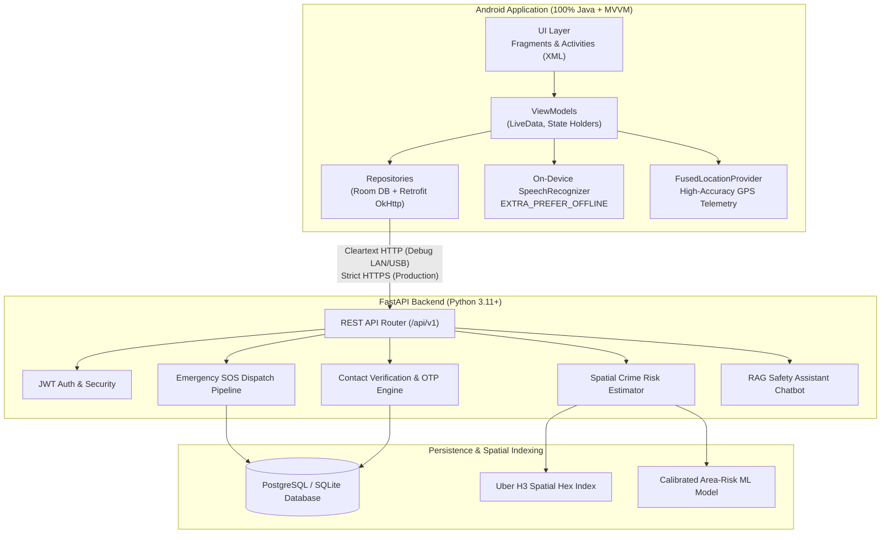

# SafePath AI — System Architecture & Design

SafePath AI is an enterprise-grade personal safety platform engineered around a strict **privacy-first, offline-resilient, and emergency-reliable** design.

---

## 1. High-Level Architecture Overview

---

## 2. Core Subsystems

### A. Android Client (`android-app/`)
* **Technology:** 100% Java (JDK 17) + XML Layouts only. Zero Kotlin, zero Jetpack Compose.
* **Architecture:** Model-View-ViewModel (MVVM) with Jetpack Architecture Components (`ViewModel`, `LiveData`, `Room`, `Navigation Component`).
* **Networking:** Retrofit 2.9 + OkHttp 4.12 with `AuthInterceptor` (JWT bearer injection) and `NetworkErrorParser` (diagnostic translation).
* **Location Service:** Background/Foreground service using Google Play Services `FusedLocationProviderClient`, reporting true accuracy radii and persisting journey waypoints locally.
* **Voice Codeword Listener:** Foreground service using Android's native `SpeechRecognizer` configured with `EXTRA_PREFER_OFFLINE = true`. **Zero raw audio is ever recorded to disk or streamed to external servers.**
* **Local Offline Storage:** Room database caches users, verified emergency contacts, active journeys, and local SOS event queues.

### B. FastAPI Backend (`backend/`)
* **Technology:** Python 3.11+, FastAPI, Pydantic v2, SQLAlchemy 2.0.
* **Database Agility:** Seamless fallback between local SQLite (for single-command local development) and PostgreSQL (for team production deployments).
* **Security:** Passwords hashed with `bcrypt` (or `passlib`), JWT tokens with `HS256`, and role-based access control.
* **Strict Safety Invariant:** Alerts are sent **only** to contacts verified via OTP who have explicitly enabled `receive_sos_alerts = true`. The system never alerts strangers or emergency services automatically.
* **Idempotency Protection:** SOS triggers pass a client-generated UUID idempotency key to prevent double alerts during poor network conditions.

### C. Area Risk Machine Learning (`ml-risk/`)
* **Spatial Binning:** Crime incidents are aggregated into Uber H3 spatial hexagonal cells (Resolution 8 / 9).
* **Calibrated Risk Engine:** Chronologically trained classifier evaluating historical crime severity, temporal factors (day/night, weekend), and density to output calibrated risk probabilities (Low, Moderate, High, Insufficient Data).
* **Safety Ethics:** Outputs descriptive guidance (e.g. "Stay in well-lit public corridors") rather than alarmist or discriminatory labels.

### D. Crime Data Processing Pipeline (`data-pipeline/`)
* **Ingestion:** Cleans, validates, and deduplicates raw crime datasets with Pydantic schemas.
* **Spatial Normalization:** Converts latitude/longitude to spatial H3 hex indexes with boundary bounding boxes.
* **Quality Reporting:** Generates comprehensive missing-value and outlier validation reports.
